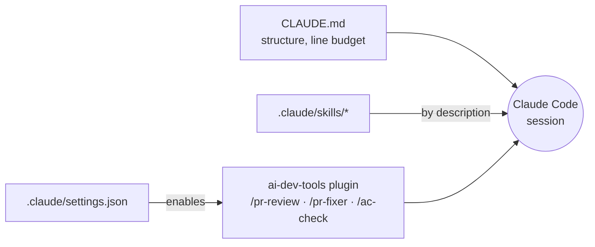

# Claude Code in this repository

This repo enables the [ai-dev-tools](https://github.com/koydas/ai-dev-tools/blob/main/README.md) plugin and ships its own skills. Rationale and layering: [ADR-018](https://github.com/koydas/ai-dev-tools/blob/main/docs/adr/ADR-018-consumer-repo-adoption.md), [consumer repos](https://github.com/koydas/ai-dev-tools/blob/main/docs/consumer-repos.md).

## Toolbox

| Where | How |
|---|---|
| Local CLI | trust the folder; the install of `ai-dev-tools@ai-dev-tools` is offered. Commands: `/ai-dev-tools:pr-review <n>`, `/ai-dev-tools:pr-fixer`, `/ai-dev-tools:issue-code-generation <n>`, `/ai-dev-tools:ac-check <n>` |
| Cloud (claude.ai/code) | repository-declared plugins are not installed: add the setup script from the [ai-dev-tools README](https://github.com/koydas/ai-dev-tools/blob/main/README.md#use-from-another-repository) to the environment. Commands are then un-prefixed (`/pr-review`) |

Repo rules win over toolbox defaults. In a multi-repository cloud session, `CLAUDE.md` and skills load for every repo; hooks and permissions do not.

## Skills

`.claude/skills/<name>/SKILL.md` — loaded on demand from the `description`. They hold procedures; invariants stay in the rule file and are linked, not restated.

| Skill | Use it when |
|---|---|
| `new-pattern` | adding or renaming a pattern: layout, README sections, `_data/patterns.yml`, index tables and counts, offline test |
