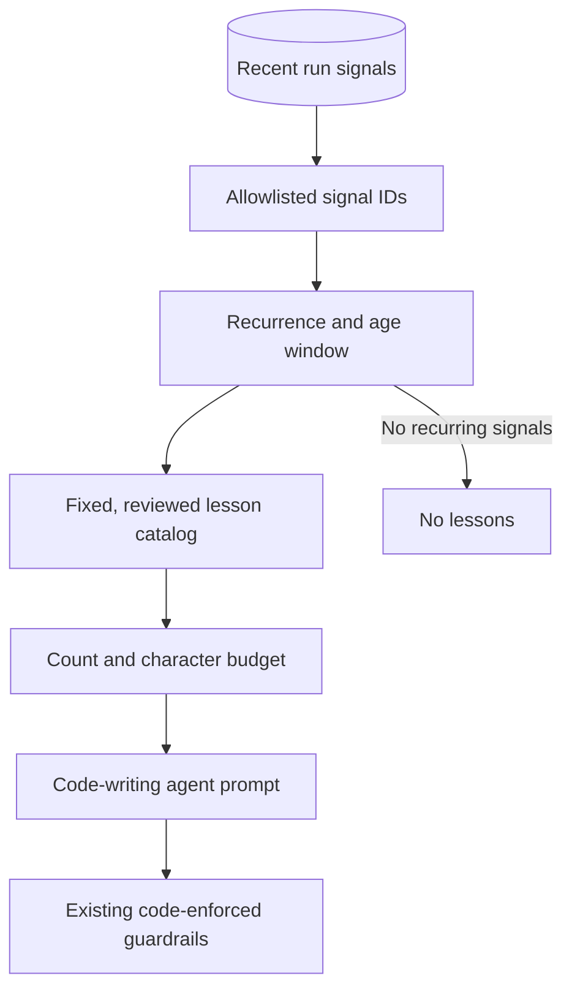

# bounded-feedback-injection



Repeated adverse signals can improve the next agent run **without letting previous model output write new instructions**. Code maps closed-vocabulary event IDs to reviewed, immutable reminders; the prompt gets only a bounded selection. The enforcement layer remains unchanged.

## How it works

1. Record adverse events as code-defined signal IDs, not free-text model explanations.
2. Reject malformed events and unknown IDs before counting.
3. Count recent signals within a fixed window and age limit; select only recurring IDs.
4. Resolve selected IDs through a reviewed lesson catalog. Never copy run records, issue text, or model-authored findings into the prompt.
5. Limit both the number of lessons and their total characters; account for the prompt token budget.
6. Inject only into stages that produce changes, **not** independent validators or reviewers.
7. Keep every existing deterministic gate. A lesson is a reminder, never permission to bypass a rule.
8. On missing history or a read failure, run without lessons and report the condition. Provide an operator-controlled off switch.

## Where it came from

[`autonomous-dev-loop` ADR-0051](https://github.com/koydas/autonomous-dev-loop/blob/main/docs/adr/0051-active-lessons-from-the-meta-loop.md) implements this in `scripts/lib/lessons.mjs` and `scripts/lib/lessons_loader.mjs`. Generation and auto-fix read coded signals from the `metrics` branch. Its current policy requires at least **2** occurrences among the newest **30** signals within **30 days**, and injects at most **3** lessons or **700** characters. `ADL_LESSONS=off` disables the feature. A metrics read failure does not fail code generation.

This is **not** [reflexive-loop](../reflexive-loop/): no agent learns arbitrary rules, and no prompt or instruction file is rewritten. It is also distinct from [read-only-meta-loop](../read-only-meta-loop/): this pattern affects the next prompt but still cannot alter gates or repository state.

## When to use

- Recurring failures have stable, machine-identifiable categories.
- A reviewed reminder can help an agent avoid a known mistake.
- The system must retain an auditable boundary between observations and instructions.

## When not to use

- The failure cannot be represented by a reliable closed vocabulary.
- The stage is an independent reviewer: prior failure reminders could bias its verdict.
- You need a measured improvement guarantee: reminders are a hypothesis, not proof.

## Trade-offs

| | |
|---|---|
| **Pro** | Bounded, inspectable adaptation without model-written prompt content |
| **Pro** | No persistent prompt edits, new write permissions, or automated gate changes |
| **Con** | Fixed lessons cannot address novel failure categories without a code change |
| **Con** | History-dependent prompts reduce reproducibility unless selected IDs are logged |
| **Con** | The effect on error rates must be evaluated; fewer rejections are not guaranteed |

## Failure modes

- **Prompt injection via telemetry:** forwarding model-originated free text into instructions. Only allow known IDs and fixed catalog strings.
- **Review contamination:** teaching the reviewer what it previously missed. Keep independent judgement stages outside the injection path.
- **Unbounded accumulation:** old failures dominate future prompts. Use recency, recurrence and size caps.
- **Gate erosion:** a lesson tells the model to bypass a safeguard. Review catalog changes and keep safeguards in code.
- **Invisible behavioral drift:** the same task gets different reminders on different days. Log the selected IDs, policy version and relevant window.
- **Availability coupling:** a metrics outage blocks a coding task. Fail open *for advice only*; never fail open for enforcement.

## Reference implementation

[`impl.mjs`](./impl.mjs) is a pure offline selection function; [`impl.test.mjs`](./impl.test.mjs) exercises recurrence, allowlisting, budgets and non-mutation. No API key or network required.

```bash
node --test patterns/bounded-feedback-injection/impl.test.mjs
```
