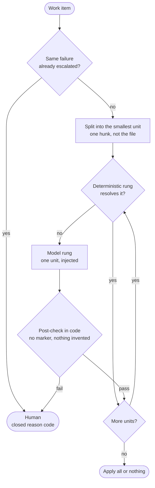

# escalation-ladder

Try the cheapest, exact mechanism first; give the model only what is left, over the smallest unit, and check its answer in code; hand the rest to a person with a reason that is a code, not model text.

## How it works

1. **Split into the smallest unit** the model could usefully resolve — a conflict hunk, not the file. What the model does not see, it cannot rewrite.
2. **Deterministic rungs first.** Identical sides, or one side unchanged since the base, resolve a hunk exactly and for free. A lockfile is regenerated by its package manager, never edited. The model is not called for them.
3. **Model rung** for what is left, one unit per call, with the three sides and nothing else. The answer is data to be checked, not a patch to be trusted.
4. **Post-check in code** per kind of unit: no marker left; nothing invented (every line comes from one of the three sides, a few combined lines tolerated); for a changelog, every entry of both sides kept. A failed check is an escalation, not a retry.
5. **All or nothing.** One refused unit refuses the whole item; a half-resolved file is never returned or pushed.
6. **Human last**, with a closed reason (`invented_content`, `marker_left`, `no_model`, `circuit_open`): enough to act on, no model text in the record.
7. **A breaker on the signature** (the conflict, not the attempt count): the same conflict that already escalated is not tried again by a loop; a person can override it.

## Where it came from

- **A conflicting PR was invisible to the loop.** `pull_request` events run on the merge ref, which does not exist while a PR conflicts, so review, CI and auto-fix went silent. The fix in `autonomous-dev-loop` is this ladder: clean merge → regenerated lockfile → model resolves hunks with per-resolver post-checks → `needs-human`, guards checked against both sides, the ADR number renumbered by code rather than by the model. → [autonomous-dev-loop#294](https://github.com/koydas/autonomous-dev-loop/pull/294) (open at the time of writing; ADR-0058 in that PR)

## When to use

- A failure class where most cases are structural and exactly solvable, and a minority need judgement.
- The model's output can be checked mechanically against its inputs.
- A wrong silent fix is worse than an escalation.

## When not to use

- Every case needs judgement: the deterministic rungs never fire and the ladder is a model call with extra steps.
- The result cannot be checked in code: a post-check you cannot write is a model you cannot bound.
- Escalating is not cheap (nobody reads the queue).

## Trade-offs

| | |
|---|---|
| **Pro** | The model sees and writes the minimum; most items cost nothing |
| **Pro** | Every refusal is a reason code a dashboard can count |
| **Con** | Post-checks bound shape (nothing invented, nothing dropped), not meaning: a plausible wrong merge passes |
| **Con** | The deterministic rungs and the post-checks are code per kind of unit, to maintain |
| **Con** | All-or-nothing escalates a file for one bad hunk |

## Failure modes

- **Whole-file output.** Asking for the file lets the model rewrite the part that was not in conflict. Ask for hunks and splice them.
- **A post-check that is too strict** escalates legitimate merges (a combined import line); too loose, it is decoration. Measure the escalation rate by reason.
- **Guarding against one side only.** Taking the base's own refactor looks like a mass deletion against the PR; check against both sides and reject only what neither side does.
- **A breaker keyed on the attempt count** is cleared by anything that resets the count; key it on the signature of the failure.
- **The model chooses an identifier** (a number, a name) that is a function of the other side. Compute it.
- **Reason text from the model in the record** leaks content; keep reasons closed.
