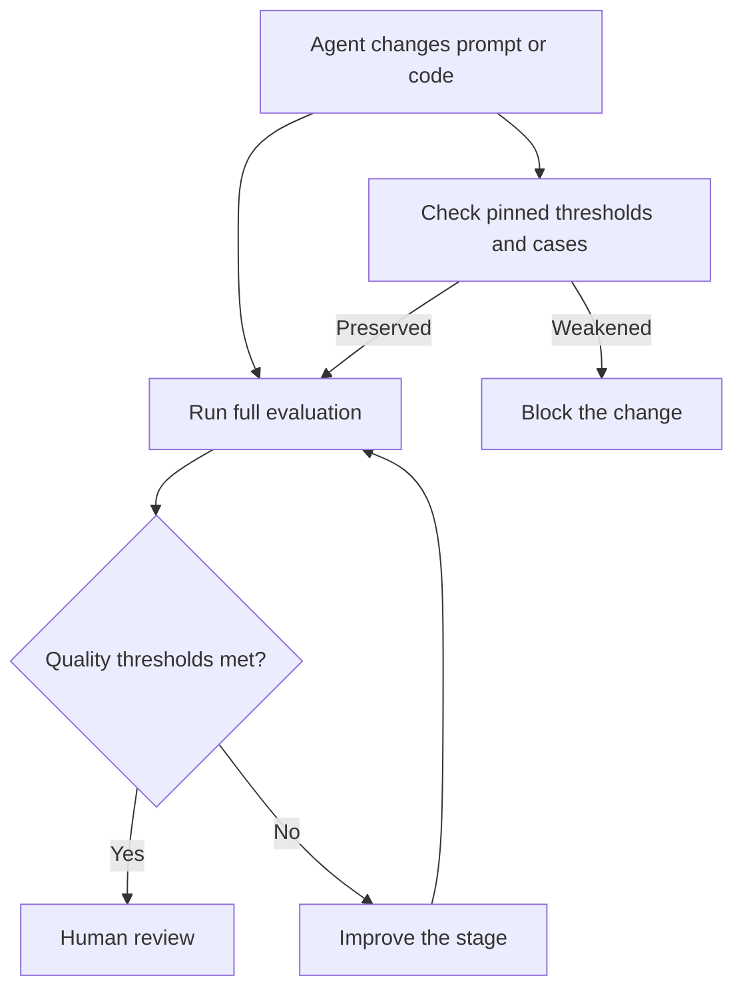

# eval-gate-ratchet



A failing evaluation must be fixed by improving the stage, not by making the evaluation easier. A deterministic **ratchet** protects minimum scores, maximum error rates, dataset cases, and full-suite execution against silent weakening.

## How it works

1. Pin the bounds and optional flags of gated metrics, along with case IDs, labels, input hashes, and a minimum gated case count.
2. Reject lower minimums, higher maximums, newly optional metrics, removed cases, or rewritten cases.
3. Ensure CI cannot silently run only selected tags or a limited subset.
4. Fix red evaluations in the stage's prompt, parser, or production code; rerun the full suite.
5. Allow tightening and adding gated cases under review. Dataset corrections or gate loosening require an explicit human decision and documented rationale.
6. Check prompt text for benchmark leakage; simple overlap tests cannot detect paraphrases.

## Where it came from

[`autonomous-dev-loop` ADR-0031](https://github.com/koydas/autonomous-dev-loop/blob/main/docs/adr/0031-eval-gates-are-a-ratchet.md) defines the rule after a harder validation dataset exposed real weaknesses. Its `scripts/tests/eval_threshold_floor.test.mjs` pins thresholds and datasets; `workflow_gates.test.mjs` prevents filtered eval runs.

The ADR also permits **new, explicitly tracked `known-gap` cases** to be measured without immediately entering gated metrics. An already gated case cannot be converted into a known gap; promotion into the gate is one-way.

## When to use

- Agents can modify prompts, evaluations, datasets, or CI workflows.
- A green eval is required before autonomous behavior can ship.
- The easiest way to pass a test would be to weaken its definition.

## When not to use

- There is no repeatable evaluation suite to protect.
- A dataset label is demonstrably wrong; correct it in a separately reviewed change.
- Metrics are exploratory rather than release gates.

## Trade-offs and failure modes

A ratchet makes green meaningful and blocks easy benchmark gaming, but harder cases can keep a suite red while a real fix is developed. Floors and hashes need maintenance. A mutable floor file is not sufficient protection by itself: require human review and repository permissions for changes to the floor. Prevent benchmark wording from being copied into production prompts, but do not mistake a passing overlap test for proof of no contamination.

See [read-only-meta-loop](../read-only-meta-loop/): it suggests improvements; this pattern protects how those improvements are measured.

## Offline example

[`impl.mjs`](./impl.mjs) demonstrates deterministic floor comparison, not the complete production CI harness.

```bash
node --test patterns/eval-gate-ratchet/impl.test.mjs
```
