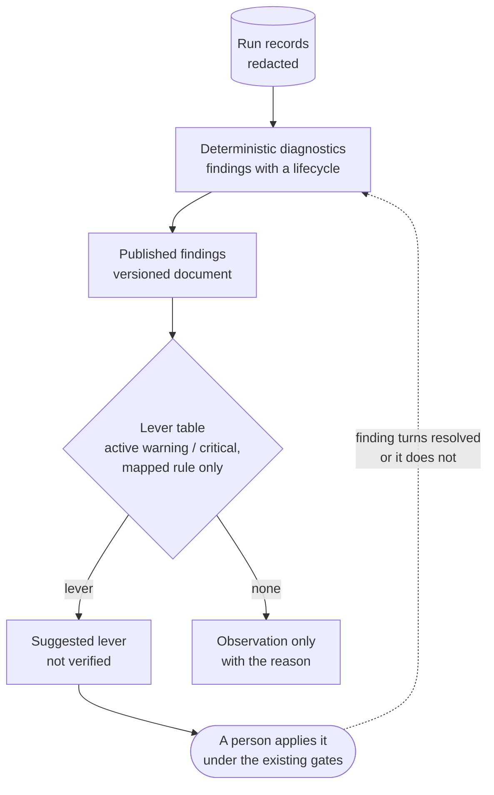

# read-only-meta-loop



A pipeline reads its own statistics and suggests where to change itself — and **writes nothing**. The step is a pure function over a published document: findings in, suggested levers out. A person applies a lever as any other change, through the gates that already guard the pipeline (evals, protected paths, review, human merge).

## How it works

1. The pipeline publishes its diagnostic findings as a versioned document (`schema_version`, a stable `key` per finding, `status` active or resolved, `fact`, optional `hypothesis`).
2. A **fixed table** maps a rule id to the setting or prompt that governs it, with, for each target, the eval suite that measures a change to it (or none).
3. A finding yields a lever only if it is **active**, of severity **warning or critical**, and from a **mapped** rule. Resolved findings, guardrails doing their job (`info`) and unmapped rules are listed under *not proposed*, each with its reason.
4. The table **may not name** the gates or the loop's own boundary: workflow files, agent config and instruction files (`.claude/`, `CLAUDE.md`, `AGENTS.md`), eval thresholds and datasets, the protected-paths list, attempt caps. A test fails if it does.
5. Every lever carries `verified: false`. It says where to look, not what the cause is.
6. Feedback needs no state: the finding turns `resolved` when the pattern leaves the recent window.

## Status

Reference implementation only (`impl.mjs`, 11 offline tests, no API key). The design is recorded in [`autonomous-dev-loop` ADR-0046](https://github.com/koydas/autonomous-dev-loop/blob/main/docs/adr/0046-meta-loop-read-only-stats-to-levers.md) and [ADR-0047](https://github.com/koydas/autonomous-dev-loop/blob/main/docs/adr/0047-findings-export-and-lever-table.md) (both *Proposed*, merged as design only); the on-demand drafting command is [`ai-dev-tools` ADR-017](https://github.com/koydas/ai-dev-tools/blob/main/docs/adr/ADR-017-loop-insights-command.md). Neither repo publishes the findings document or the lever table yet. This page moves to "running in" when they do.

```bash
node patterns/read-only-meta-loop/impl.mjs                         # a sample findings document → proposals
node --test patterns/read-only-meta-loop/impl.test.mjs
```

## Where it came from

- **Whatever the meta-loop creates comes back as input.** The first design opened one GitHub issue per finding. In `autonomous-dev-loop`, the issue-validation workflow fires on every issue opened or edited, so each proposal would be validated by an LLM, labelled ready-for-dev, handed to code generation (which the write denylist then blocks), and counted as a work item in the pipeline's own KPIs. A draft PR triggers the review; a rolling issue edited in place triggers validation on every refresh. The output had to be something the pipeline does not react to. → [ADR-0046](https://github.com/koydas/autonomous-dev-loop/blob/main/docs/adr/0046-meta-loop-read-only-stats-to-levers.md)
- **A table is checkable; a model's suggestion is not.** The diagnostics deliberately have no LLM: a generated explanation can present a hypothesis as a fact. The lever table is data with invariants a test can enforce (no forbidden target, every rule mapped or explained). → [ADR-0043](https://github.com/koydas/autonomous-dev-loop/blob/main/docs/adr/0043-diagnostic-observability-console.md), [ADR-0047](https://github.com/koydas/autonomous-dev-loop/blob/main/docs/adr/0047-findings-export-and-lever-table.md)
- **Loosening a gate is the cheapest way to turn a signal green.** A failing eval can be fixed in the stage or by lowering its threshold; the second is always cheaper and always wrong. A lever that could name a threshold would automate it. → [ADR-0031](https://github.com/koydas/autonomous-dev-loop/blob/main/docs/adr/0031-eval-gates-are-a-ratchet.md)
- **A reviewer caught two real inconsistencies in the design itself.** The first table named a workflow file as a lever while forbidding `.github/`, and gave one eval gate to a whole entry although one of its prompts had its own suite. The gate is now per target and the workflow lever became "no lever".

## When to use

- A pipeline already records and diagnoses itself, and the people running it repeat the same search: *which setting governs this?*
- The settings that matter are few, named, and keyed (budgets, providers, a prompt file) — a table can cover them.
- The pipeline's own actions create objects it listens to (issues, labels, PRs, comments).

## When not to use

- Nothing diagnoses the pipeline yet: build the findings first; a lever table over raw logs is a guess.
- You want the loop to **apply** the change. That is a different, much riskier pattern ([reflexive-loop](../reflexive-loop/)): it needs its own write boundary, holdout evaluation and rollback, and is not what this page gives you.
- Low run volume: the first levers will be few. The pattern says so (*not proposed*), it does not invent more.
- The causes are not in the settings (a model regression, an upstream outage): the table has nothing to point at.

## Trade-offs

| | |
|---|---|
| **Pro** | Cannot loop on itself: it creates nothing the pipeline reacts to, and adds no population to its own indicators |
| **Pro** | No new secret, token scope or permission; deterministic and unit-testable |
| **Pro** | The boundary is enforced by a test, not by a prompt |
| **Con** | Pull, not push: a suggestion is seen only by someone who looks |
| **Con** | No memory of a rejected suggestion: it shows again while its finding is active |
| **Con** | The table is maintained by hand next to the rules; the exhaustiveness check turns a new rule without a decision into a red test, not a silent gap |
| **Con** | Only as good as the statistics: a handful of days of runs gives few levers |

## Failure modes

- **Table drift** — a setting is renamed and the lever points at nothing. Mitigation: resolve every target against the file it names in a test.
- **Guardrail read as a defect** — a designed block counts as an anomaly and produces a lever. Mitigation: classify guardrail vs anomaly in the diagnosis, and let only `warning`/`critical` through; `info` is a guardrail doing its job.
- **Lever read as cause** — the suggestion is taken for a root cause. Mitigation: `verified: false` on every lever, hypothesis kept separate and labelled, facts quoted verbatim.
- **Untrusted text in the document** — some free-text fields carry text originating from a model. Any consumer that is itself an LLM must treat them as data, never as instructions, and run without write tools.
- **Silent weakening** — a later change adds a lever on a threshold "just this once". Mitigation: the forbidden-target test; changing it needs a decision record.

## Related

- [reflexive-loop](../reflexive-loop/) writes learned rules back into the instruction set; this pattern is its read-only counterpart. Start here; reach for the other only with a write boundary, a holdout set and a rollback.
- [human-gate](../human-gate/) is what applies a lever: a person, under the gates that already exist.
- [validator-first](../validator-first/) and [tool-grounded-review](../tool-grounded-review/) are the gates a lever is not allowed to weaken.
