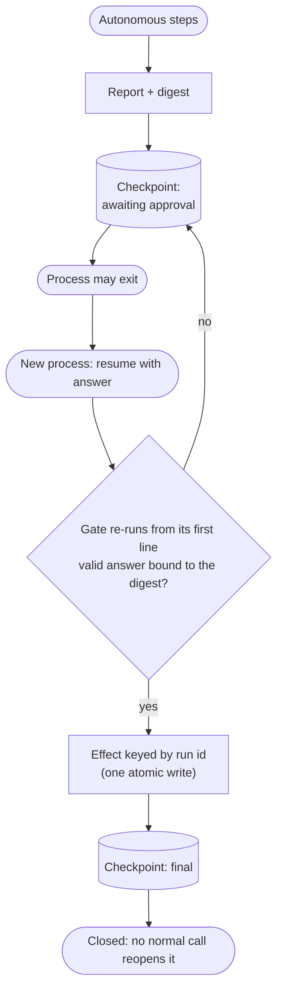

# resumable-approval-gate

[human-gate](../human-gate/) says *where* the human sits. This pattern is what the gate must do when the pause outlives the process: the approval is durable, the node that waits is re-executed on resume, and the irreversible effect must not run twice because of it.

## How it works

1. The run produces a report and its **digest**, writes a checkpoint (`awaiting_approval`) and may exit.
2. A later process loads the checkpoint by run id and resumes with an answer: decision, reviewer, and the digest of the report the reviewer saw.
3. The gate validates the answer. A stale digest, an unknown decision or a missing reviewer **pauses again**; nothing is published.
4. The effect is the only side effect and it lives **after** the gate, not inside it. Its idempotency key and the effect are one atomic write, so a replay is a no-op.
5. The final checkpoint is terminal. A start input on an existing run id is refused before the runtime is touched, and `resume` on a finalized run raises.

## When to use

- A human pause that can last longer than any process (hours, days), on a runtime that checkpoints state.
- Workflow engines that **restart an interrupted node from its first line** on resume (LangGraph `interrupt()` does; observed on `langgraph` 1.2.19).
- Any final action you cannot take back: a publication, a comment, a charge.

## When not to use

- The approval happens inside one process lifetime (a terminal `y/n`): plain [human-gate](../human-gate/) suffices.
- The effect is already idempotent and cheap to repeat, and no state is bound to the report.

## Trade-offs

| | |
|---|---|
| **Pro** | A killed process costs one replayed node, not a duplicated effect |
| **Pro** | An approval cannot be applied to a report the reviewer did not see |
| **Con** | Needs an idempotency key the *target* honors, or read-before-write; for an external API this is the hard part, the reference code only models it with a keyed ledger |
| **Con** | A second durable store (the ledger) next to the checkpoint |

## Failure modes

- **Effect before the wait** — a side effect placed above the `interrupt()` call runs once per resume; keep the waiting node pure.
- **Start input on a live thread** — in LangGraph, a raw start input on a paused thread fails in the first node yet leaves it pending, superseding the interrupt (the run is wedged until someone forks from an earlier checkpoint). Refuse in the facade first; do not rely on a guard inside the graph.
- **Key and effect in two writes** — a crash between them either repeats or loses the effect; commit them together.
- **Replay with a different decision** — after the effect committed, a retry that says "reject" must not finalize as rejected; recovery uses the committed entry and refuses a conflict.
- **Mutable report** — the digest binds the report only if the stored report is a snapshot and is re-verified before publishing.
- **Digest not bound** — an approval typed for report A applied to report B after a replay.
- **State edit as input** — `Command(update=...)` is ordinary input in LangGraph and can reset counters; keep budgets in a store the checkpoint cannot rewrite.

Reference only: validated by the S0 spike in [`repo-orchestrator`](https://github.com/koydas/repo-orchestrator) (`prototypes/langgraph-spike`), not running in a pipeline.
