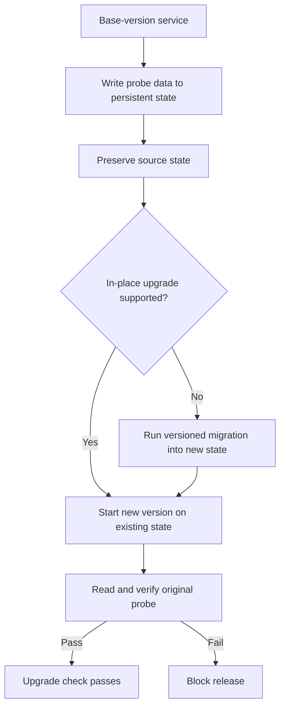

# stateful-upgrade-verification



A green fresh-install test does not prove a stateful system can upgrade. Verify the transition from the **previous version's real persisted data** to the proposed version, not merely that the new version boots with empty storage.

**Scope note:** this is a general CI and reliability pattern, not an agent-specific orchestration pattern. It belongs in an agent-system catalog when agents can propose dependency or infrastructure upgrades and the deterministic gate must protect persisted state.

## How it works

1. Start the base-version service with persistent storage and seed an identifiable probe.
2. Stop it and preserve the old state or a recoverable backup.
3. Choose the documented migration path. Never mount an incompatible old data directory under a new engine merely to see whether it boots.
4. Start the proposed version against migrated or compatible state.
5. Read the original probe and assert its values; fail on start, migration or data-integrity errors.
6. Require this check for changes to stateful images or migration scripts, independently of an agent's claim that the upgrade is safe.
7. Document rollback separately. Successful forward migration does **not** prove downgrade compatibility.

## Where it came from

[`fullstack-pilot` ADR-005](https://github.com/koydas/fullstack-pilot/blob/main/docs/adr/ADR-005-database-major-upgrades.md) requires a migration tested in CI for major database upgrades. Its [database upgrade harness](https://github.com/koydas/fullstack-pilot/blob/main/.devops/tests/db-upgrade/README.md) seeds data with the base image and verifies readability with the proposed image. PostgreSQL major upgrades use a versioned dump-and-restore script on a new volume when necessary; upgrades supported in place are tested on the same volume. The harness distinguishes setup failure, incompatible data, unreadable data and migration failure.

## When to use

- Agents or humans update database, queue, index or storage-engine versions.
- Persistent data must survive upgrades across a deployed fleet.
- Fresh-volume smoke tests are the only current CI coverage.

## When not to use

- A stateless service with no persisted format or migration surface.
- As a substitute for production backup, restore drills, or rollback planning.
- To claim zero-downtime migration: this check does not establish availability during upgrade.

## Trade-offs

| | |
|---|---|
| **Pro** | Catches compatibility regressions invisible to clean-install tests |
| **Pro** | Makes the upgrade path an executable release contract |
| **Con** | Requires old images, persistent volumes and sometimes engine-specific migration scripts |
| **Con** | Probe coverage may miss schema or data edge cases |
| **Con** | Passing forward migration does not prove reversibility |

## Failure modes

- **Empty-volume false confidence:** only the new version is tested.
- **Destructive trial:** an incompatible new engine modifies the sole copy of old data. Preserve it first.
- **False rollback promise:** an in-place upgrade changes storage irreversibly. Document backups and restore strategy.
- **Weak probe:** checking only process health, not old records. Verify meaningful data round trips.
- **Misleading green:** a test setup error is treated as success. Distinguish setup, compatibility, migration and read failures.

## Reference implementation

[`impl.mjs`](./impl.mjs) is an offline state-transition simulator that verifies preserved probe data and rejects incompatible upgrades without migration. It is **not** a database migration harness. The production-grade Docker-based implementation remains in `fullstack-pilot`.

```bash
node --test patterns/stateful-upgrade-verification/impl.test.mjs
```
